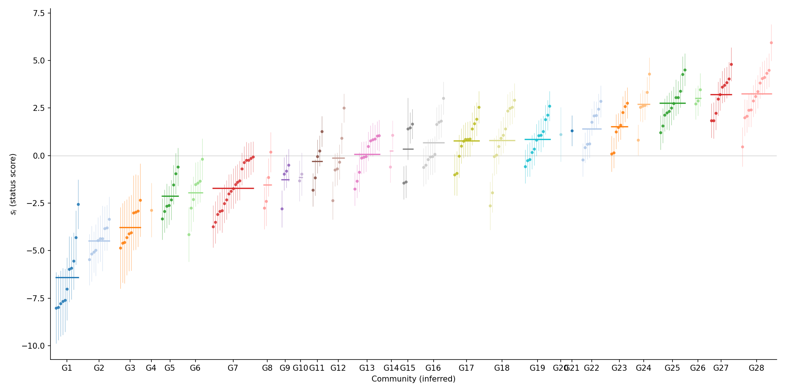
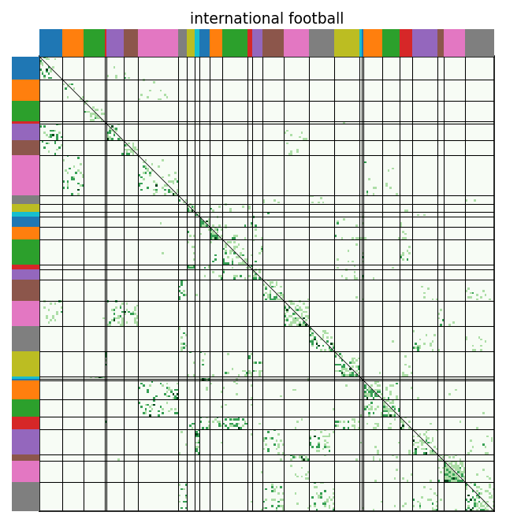
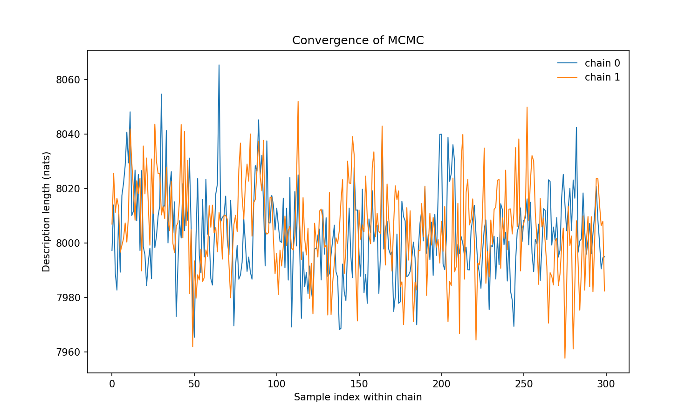

# Example: international football

A complete fit of the international football network (216 national teams, every
competitive match from September 2023 to the end of the 2026 World Cup group stage),
with the summaries and plots the package provides.  Run it from the repository root:

```bash
python examples/python/example.py
```

```{literalinclude} ../../examples/python/example.py
:language: python
```

Scores within each consensus group (posterior mean ± sd):



The adjacency matrix ordered by group:



The description length of each chain, which should fluctuate around a stationary level
after burn-in:


